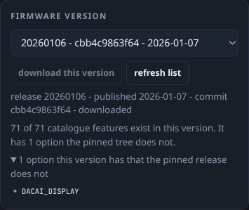

# Ender 3 S1 firmware factory

**Pick any upstream checkpoint, pick features, get a verified image and a written card — with every cost measured in bytes, not estimated.**

[](CHANGELOG.md)
[](docs/BUILD.md)
[](docs/HARDWARE.md)
[](docs/DESIGN-NOTES.md)
[](LICENSE)
[](https://github.com/darthinvader/Ender3S1Firmware/actions/workflows/verify.yml)
[](https://github.com/darthinvader/Ender3S1Firmware/actions/workflows/build.yml)
[](https://github.com/darthinvader/Ender3S1Firmware/actions/workflows/configurator.yml)

This repository is a **build service for Ender 3 S1-class Marlin firmware**, plus the reference build it was written for. The service starts from **any upstream mriscoc checkpoint** — a release tag or a branch, fetched on demand — applies a feature selection, compiles it, checks the ARM vector table, and hands back an image, a manifest and a ready SD card for both the mainboard and the display.

The reference build uses **232,344 of the 233,472 available bytes** — 1,128 bytes free. That constraint is why the service exists: it can tell you what a feature costs **before** it compiles, because every price in the catalogue came from building that feature on and off. On the reference build the predictor's error is **0 bytes**.

It ships the service, the measurement harness behind the catalogue, the compiled binaries with their manifests, the screen-recovery kit, and the calibration record — including the parts that did not work.

---

**For hiring managers and reviewers:** [docs/PORTFOLIO.md](docs/PORTFOLIO.md) is the same project in CV form - one line, four bullets, the skills with a receipt for each, and an explicit split between what I wrote and what is upstream. Everything in it is checkable from this repository.

## What this is

| | |
|---|---|
| Machine | Creality Ender 3 S1 (non-Pro), 220 x 220 x 270 mm, Sprite direct drive, CR Touch |
| Board | Creality v2.4.S1.301, STM32F103**RCT6** - 256 KiB flash, 48 KiB RAM |
| Firmware | Marlin `bugfix-2.1.x` via [mriscoc Professional Firmware](https://github.com/mriscoc/Ender3V2S1) 2.1.4, custom configuration |
| Current build | `Ender3S1-F1-v2` - 2026-07-30 - md5 `6e11c30095187fd50a62fa75904379f0` |
| Flash / RAM | 232,344 / 233,472 B (99.5 %, 1,128 B free) and 28,064 / 49,152 B (57.1 %) |
| Screen | DACAI 4.3&quot;, official V3.1.9 OS + matching asset set - recovered from a brick |
| Status | Running on the machine. `M115` reported `Ender3S1-F1-v2 (Jul 30 2026 16:04:49)` on 2026-09-21 and again on 2026-10-01 - the exact string compiled into the shipped image |

## Why it exists

The stock Creality V1.0.6_C firmware is a 2022 build with classic jerk, no linear advance, no input shaping, no junction deviation and no unified bed leveling. On this machine that shows up as ghosting on every vertical wall and a hotend that can only be trusted at moderate speed.

The replacement had to deliver four things at once:

1. **Measurably less ringing** - solved with input shaping, but only after the frequencies were *measured* rather than guessed.
2. **Consistent extrusion across speed changes** - solved with linear advance plus a smooth-flow variant.
3. **A bed that does not need chasing** - solved with UBL, a 7x7 mesh, and multiple probing per point.
4. **A hotend model that does not oscillate** - solved with MPC replacing PID.

All four had to fit in a region that was already 88 % full. [docs/DESIGN-NOTES.md](docs/DESIGN-NOTES.md) is the engineering account of what was paid for what.


## The constraint, in one picture


233,472 bytes are available to the application, and the shipped build occupies 232,344 of them. That is the whole design problem in one image - and the reason several features in this repository are one source line rather than a configuration flag.


## Feature set

| Feature | What it does | State on this machine |
|---|---|---|
| **UBL, 7x7 mesh** | Auto bed leveling with a saved mesh | Active, slot 0, probed hot at 60 C |
| **Input shaping X/Y/Z** | Cancels frame resonance (`M593`) | `F48 D0.08` on both axes, derived by photo FFT |
| **Linear advance + smooth LA** | Pressure compensation, with a ramp instead of a step | `M900 K0.08 U0.02` |
| **MPC + PTC model** | Predictive hotend control instead of PID | Autotuned, `M306` in EEPROM |
| **Binary file transfer** | Cable flashing through the host instead of the SD dance | Compiled in, `Cap:CUSTOM_FIRMWARE_UPLOAD:1` |
| **Multiple probing** | Two touches plus one extra per mesh point | On, 7x7 grid |
| **EP babystepping** | Live Z from the host (`M293`/`M294`) | Used during first-layer tuning |
| **G-code macros in EEPROM** | Five stored macros (`M810`-`M819`) | Compiled in |
| **Skew correction** | `M852` compensation for a non-square frame | Compiled in, identity (nothing measured) |
| **Nonlinear extrusion** | `M592` flow shaping at high back-pressure | Compiled in, inert until calibrated |
| **Nozzle clean (G12)** | Automated nozzle wipe | Compiled in |
| **Fan kickstart** | 100 ms boost so the part fan starts reliably | On |
| **Larger buffers** | 32-block planner, 32-line RX/TX, 512-byte RX | On, helps host throughput |

Everything above is also in [docs/DESIGN-NOTES.md](docs/DESIGN-NOTES.md) with the reason it was kept, what it cost in bytes, and what was rejected.

## Repository layout

```text
.
|-- firmware/                  compiled images, checksummed
|   |-- Ender3S1-F1-v2-20260730.bin        current build (32 KiB larger feature set than v1)
|   |-- Ender3S1-F1-UBL-IS-LA-MPC-BFT-20260728.bin   previous known-good build
|   |-- upstream/              mriscoc reference builds, for comparison
|   |-- stock/                 official Creality V1.0.6_C rollback image
|   |-- SHA256SUMS             everything above, verified in CI
|   `-- flash-filenames.txt    which SD filenames this printer has already consumed
|-- configs/                   the exact build input, byte for byte
|   |-- Ender3S1-F1-v2/        Configuration.h, Configuration_adv.h, Version.h, platformio.ini
|   |-- Ender3S1-F1-UBL-IS-LA-MPC-BFT/
|   |-- recipes/               the configurator recipe and every hand edit, with file:line
|   |-- features/              the custom re-enable of binary file transfer
|   `-- patches/               0001 is the recorded config delta, 0002 the required source fix
|-- screen/                    DACAI display: OS image + matching asset set
|-- calibration/               EEPROM dumps, as measured
|-- logs/                      full build logs for both variants
|-- scripts/                   bootstrap, build, verify, flash-card
|-- docs/                      the documentation set below
|-- Makefile                   thin wrappers, nothing hidden
|-- tools/configurator/        web UI + compile service (feature toggles, budget, build, any version)
`-- .github/workflows/         checksum + config + docs verification
```

## Quick start

**Verify what you downloaded** (checksums, ARM vector tables, configuration sanity, doc links):

```bash
make verify
```

**Flash the current build** - write an SD card with a filename this printer has never seen, then follow the bootloader procedure:

```bash
./scripts/flash-card.sh --device /dev/sdX --bin firmware/Ender3S1-F1-v2-20260730.bin
./scripts/flash-card.sh --device /dev/sdX --bin firmware/Ender3S1-F1-v2-20260730.bin --yes
```

Then `M115` at **250000 baud** must report `Ender3S1-F1-v2`. Full procedure, failure ladder and post-flash checklist: [docs/FLASHING.md](docs/FLASHING.md).

**Rebuild it from source** (pinned upstream commits, exact PlatformIO version):

```bash
./scripts/bootstrap.sh              # clone pins, install configs, create build/.venv
./scripts/build.sh                  # compile, stage in build/out/
```

The whole chain is five scripts and one configuration folder:


Reproducibility caveat worth stating up front: the binaries embed their build date and time (`__DATE__` / `__TIME__` in Version.h), so a rebuild is **not byte-identical**. The meaningful comparison is flash size, RAM usage and the `M115` version string. See [docs/BUILD.md](docs/BUILD.md).

## Run the configurator (one command)

```bash
./scripts/configurator.sh
```

That is the whole setup. On the first run it bootstraps the pinned Marlin tree and PlatformIO (a few minutes, once), starts the local service, waits until it answers, opens `http://127.0.0.1:8787` in your browser and prints the URL. On later runs it starts in about a second. **Ctrl+C stops it.**

| Option | What it does |
|---|---|
| `--no-open` | print the URL instead of opening a browser (servers, SSH) |
| `--port=9000` | use another port (or set `CONFIGURATOR_PORT`) |
| `--no-bootstrap` | fail with instructions instead of downloading the toolchain |
| `--help` | the same table, from the terminal |

If the service is already running, the script says so and exits instead of starting a second copy on the same port. `make configurator` is the same thing.

### Using the page

1. **Machine** (top right) - the board this image is for. Only supported boards are offered.
2. **Firmware version** - the pinned commit by default, or any mriscoc release or branch: pick it, press *download this version*, and the page clones it and offers to build it. Measured costs only apply to the pinned tree; other versions are built and reported at their real size.
3. **Features** (left) - filter, or use a preset: *What I run now*, *Minimum*, *Add what fits*. Each row states its measured flash and RAM cost. Features that need the screen's own items pull them in automatically, and conflicts are refused before a compiler starts.
4. **Mesh size** - the default bed mesh (3x3 to 9x9). The firmware accepts any size up to 9 at runtime; the build only sets what a fresh EEPROM starts with.
5. **Screen** - pick the panel OS and asset pack that pair with custom firmware; the bundle carries both.
6. **Build** - watch the flash budget, press *Build firmware*. The Result card gives the real flash/RAM, the sha256, `.bin`, `manifest.json` and `bundle.zip`.
7. **Write the card** - optional: pick the device, choose what goes on it, confirm the modal, and the service formats and writes it, md5-checking every copy.

Everything on the page is served from the same process - there is no separate frontend build step, and no network access is needed for the pinned tree.

## Configurator (optional)

**Build one online:** [ender3s1-firmware.pages.dev/cloud](https://ender3s1-firmware.pages.dev/cloud/) - switch features off, request the build, download the image. No server, no account, no bill; the workflow in this repository does the compiling and publishes each selection as a release.

### From a browser, with nothing installed

The page is static; two Cloudflare Pages functions sit behind it. A press of **Build firmware** dispatches *configurator.yml*, and the answer comes back as a release asset.

| Step | What happens |
|---|---|
| Pick | tick features, a preset, the mesh size - the flash budget moves as you tick, because every price is measured |
| Build | the button itself carries the state: **In the queue (12 s)** then **Compiling: compiling (48 s)** then **Published - download below**. Under it a small terminal lists the workflow steps as the runner reaches them, one line per transition |
| Take it | result card with the .bin, the manifest, the bundle, the build log and the checksums |

A selection that was built before is served from its release immediately: the tag is a hash of the selection, so the same choices always name the same image.

**Writing the card.** Three steps, and nothing is copied until the copy button is pressed:

1. *Choose the SD card* - a folder picker. Choosing a folder copies nothing.
2. *Select what to copy* - firmware image (with its size), manifest, screen image and assets.
3. *Copy* - the button says what it will do (**Copy 2 files to SDCARD**) and the page reports each file as it lands.

The image is written as firmware-xxxxxx.bin, a fresh name every time, because the panel ignores a firmware.bin it has already flashed. Folder writing needs Chrome or Edge (the File System Access API); Firefox and Safari get **Download the bundle (.zip)** instead - the same files in one archive. The page copies files onto a FAT32 card; it cannot format one.

| Route | Answers |
|---|---|
| POST /api/build | validates the selection, serves it from a release when the tag exists, otherwise dispatches the workflow and returns the run id |
| GET /api/build/&lt;tag&gt; | queued or running with the steps the runner has reached, or done with the asset list |
| GET /api/file | streams a release asset from the site's own origin, because browsers cannot read GitHub release assets (no CORS); with raw=screen/... it serves the screen packages |

It also runs locally in one command; if you want it on a server, [docs/HOSTING.md](docs/HOSTING.md) has the measured requirements and free-forever options ([deploy/](deploy) has the Docker image, compose file, systemd unit and tunnel config).


*Eight numbered frames, each one ringed on the control it talks about: pick a checkpoint, filter a feature, see its measured cost, turn it off, watch the budget, build, read the verified result, and write the card.*


A local web app does the feature picking and the compiling for you: tick what you want, watch the flash budget, press build, download the image.

```bash
./scripts/bootstrap.sh                      # once: pinned sources + PlatformIO
python3 tools/configurator/server.py        # -> http://127.0.0.1:8787
```

It applies your selection to the same pinned tree, refuses combinations that cannot fit, stamps the result `Ender3S1-CFG` so `M115` identifies it, and tells you whether the image is **bigger or smaller than the one you run now**.

The catalogue holds **71 features** - everything installable on this board, not only what the current build happens to include. Three presets: **What I run now** (your exact feature set), **Minimum**, and **Add what fits** (starts from your set and adds every measured feature that still fits, cheapest first).

The screen is part of the download too. The panel's own firmware cannot be compiled here - its OS is a proprietary blob and its menus are drawn from the mainboard defines above - so the configurator bundles it instead: pick the OS image and the asset pack, and **Download bundle (.zip)** gives you `firmware.bin`, the screen files and the flashing order in one archive. A pack that does not pair with custom firmware is refused with the reason, because that mismatch is what bricked the panel in July.

It also writes the card. Pick the device from the ones the machine actually has, say whether the mainboard image, the screen package or both go on it, and the service reformats it MBR + FAT32 with 4096-byte clusters, renames the image to an unused 8.3 name, copies the screen files, md5-compares every copy and records the filename in the registry. Internal disks are refused, a mounted card is unmounted first, and the erasure is confirmed in a modal that names the device.

And it will not stop you from building an image that cannot fit. Over the region the button turns red and says by how many bytes, a line under it explains the consequence, and a modal asks before anything runs - because your board may have more flash than the preset assumes, or you may be measuring what a configuration would need. The linker is the authority.

The bed mesh is a first-class control too: the page picks the **default** size (3x3, 5x5, 7x7, 9x9) and says plainly that the firmware then lets you probe any size from 3 to 9 in *Mesh Leveling > Mesh Points*, saved with `M500`. All four cost the same, because the matrix is a fixed 9x9; ten or more cannot link against mriscoc's precompiled ProUI library, so the page refuses it with that reason.

Dependencies are enforced in both directions: asking for the screen's linear-advance tuning item switches linear advance back on (`auto_added` in the manifest), turning linear advance off removes the screen item, and mutually exclusive pairs are refused before a compiler starts.

Every cost is measured, not estimated: each feature was compiled, on-features by turning them off against the shipped build, off-features against a slimmed baseline with room to grow. `tools/configurator/measure.py` runs the loop, `merge_measurements.py` writes the numbers back, and the catalogue validation in `make verify` proves every define still exists exactly once. Details: [tools/configurator/README.md](tools/configurator/README.md).

### Any version, not just the pinned one

The page also builds mriscoc releases and branches that are not in this repository. The list comes from the GitHub API when the page loads - cached for an hour, **refresh list** asks again - with the pinned commit first, then release tags newest-first, then the active branches, each with its commit and date.

| Choice | Prediction | What happens |
|---|---|---|
| **pinned** (default) | measured costs, exact delta against the image you run | the tree this repository is built from |
| a release tag, e.g. `20260106` | **not measured** | *download this version* puts a shallow clone in `build/sources/`, then the same compile runs against that tree |
| a branch, e.g. `Ender3V2S1-Bugfix` | **not measured** | same, at the commit the branch points to today |

Measured costs are a property of the pinned tree, so no prediction is claimed for any other version: the budget line reads *not measured* and the result reports what the linker produced. Very old trees stop at the dependency scan for a reason they name themselves - 2022 predates `DGUS_UI_IS` and ProUIex, so it cannot compile this configuration, and no image is produced. Builds against other trees are tolerant - an option the tree does not contain is skipped and listed in the manifest (`skipped`) instead of breaking the compile - and the page lists the options that version has which the pinned release does not, before you build.



## The screen is a second computer

The display runs its own firmware on its own microSD slot, and it bricked during this project: black but backlit, mainboard perfectly healthy.

| | |
|---|---|
| What bricked it | mriscoc's `firmware.zlib`, md5 `728a92a835df3f812271dc2be3482fe1` - **never flash this** |
| What fixed it | official Creality V3.1.9 (Two_C) OS, md5 `b99abe7a1388e52e2439b8b85c64fbc6` |
| plus | the matching mriscoc DACAI asset set, shipped here |
| Never | `dcboot.bin`, which locks the panel to Creality-only firmware |

The bricking file is deliberately **not** in this repository - the hash is published instead so it can be recognised. Recovery procedure, the asset-size ceiling and the DACAI/DWIN distinction: [docs/SCREEN.md](docs/SCREEN.md).

## Calibration at a glance

The full table with the measurement method for each value is in [docs/CALIBRATION.md](docs/CALIBRATION.md). These are **machine-specific** - they belong to this exact printer:

| Setting | Value | How it was set |
|---|---|---|
| E steps | `M92 E428` | filament mark test |
| Probe offset | `M851 X-31.80 Y-40.50 Z-3.10` | geometry + print evidence |
| Junction deviation | `M205 J0.02` | derived; configurator default is far too hot |
| Bed PID | `M304 P83.18 I15.04 D306.76` | autotune |
| Hotend MPC | `M306 E0 P40 C13.24 R0.2164 A0.0919 F0.1053 H0.0056` | `M306 T` autotune |
| Input shaping | `M593 X F48 D0.08` / `M593 Y F48 D0.08` | FFT of photos of printed cube faces |
| Linear advance | `M900 K0.08 U0.02` | K-factor pattern |
| Runout sensor | `M412 S1 D200` | present on the machine, disabled by default in firmware |
| Measured flow ceiling | ~9.0 mm3/s clean at 220 C | stepped vase tower |

## What was actually hard

Four problems here were not configuration problems, and each one cost real time. They are documented because the next person with this board will hit them too:

**1. Five silent flash failures.** The Creality SD bootloader remembers the last filename it flashed and silently skips a repeat of that name. Every early attempt used `firmware.bin`. The fix is a unique 8.3 name per attempt - now enforced by `scripts/flash-card.sh`, which keeps the used-name registry in [firmware/flash-filenames.txt](firmware/flash-filenames.txt) and refuses to reuse one.

**2. Two upstream bugs, one file of flash headroom.** The ProUI extended UI hard-errors when `MULTIPLE_PROBING` is enabled without `EXTRA_PROBING 1`. And enabling `INPUT_SHAPING_Z` makes `dwin.cpp` reference an `ICON_ShapingZ` alias that upstream never defines - that needed the one-line source patch in [configs/patches/0002-proui-add-ICON_ShapingZ.patch](configs/patches/0002-proui-add-ICON_ShapingZ.patch). Both are recorded as patches, not as tribal knowledge.

**3. Fitting the feature set into 1,128 bytes.** The order matters: reclaim first, then measure, then decide. Disabling two EEPROM conveniences bought 444 bytes - and made a reflash stop wiping calibration, which turned out to be an improvement rather than a compromise.

**4. Guessing the shaping frequency did not work.** An eyeball sweep landed at 55/58 Hz and left a 1.65 mm ripple at 80 mm/s. FFT analysis of photographs of printed cube faces said 48 Hz, and `D0.15` still left a residual - the damping value, not the frequency, was wrong. `F48 D0.08` removed the artefact on both axes. The method, and the two resonances that shaping cannot fix, are in [docs/CALIBRATION.md](docs/CALIBRATION.md).

## Verification

What is checked mechanically, on every push and locally with `make verify`:

| Check | What it proves |
|---|---|
| SHA-256 manifests for `firmware/` and `screen/` | the committed binaries are unmodified |
| ARM vector table of every `.bin` | initial SP in SRAM, reset handler inside the application region - i.e. not an image for the wrong board |
| Configuration assertions | the shipped config still carries UBL, the 7x7 mesh, the stock thermistor, input shaping, linear advance and binary transfer |
| Relative-link check over all Markdown | the documentation does not rot |
| Full rebuild in CI | the pinned upstream commits plus the committed configuration still compile |
| `scripts/selftest-configurator.py` | 14 behavioural checks against a live service: routes answer, paths cannot escape their directory, bad machine/version/mesh requests are refused, oversized bodies are rejected |

### Measured reproducibility

On 2026-10-27 a fresh ``bootstrap.sh`` + ``build.sh`` from the pinned commits produced an image that differs from [firmware/Ender3S1-F1-v2-20260730.bin](firmware/Ender3S1-F1-v2-20260730.bin) in **16 bytes**. Both clusters lie inside the embedded build stamp (`Jul 30 2026 16:04:49` became `Oct 27 2026 14:41:40`). Everything else is identical: file size 232,972 B, flash footprint 232,344 B, RAM 28,064 B and reset vector `0x080092C5`.

That is the useful definition of reproducible for this build - the source and configuration reproduce the image, and only the timestamp compiled into it moves.

### What is deliberately not claimed

A firmware repository that says everything works is not telling you anything. This one:

* **cannot** be checked bit-for-bit after a rebuild - the image embeds its build timestamp. Size and `M115` are the comparable properties.
* **does not** treat cable flashing as proven here: binary file transfer is compiled in and reports the capability, but every flash in this project went over SD. The SD path is the one with a track record.
* **documents** the BOOT0 + `stm32flash` recovery path but has never needed to use it.
* **was** verified as the running firmware, not just as a file: the `M115` answer captured on 2026-09-21 and 2026-10-01 matches the `FIRMWARE_NAME` string inside [firmware/Ender3S1-F1-v2-20260730.bin](firmware/Ender3S1-F1-v2-20260730.bin) character for character, including the build stamp and UUID. The flash itself happened on 2026-07-30, before the retained session history starts, so it is evidenced by the artifacts written that afternoon rather than by a saved console transcript.
* **ships** machine-specific calibration values as a record, not as a recommendation. Copying `M205 J0.02` or `Z-3.10` to another printer without measuring is guesswork.
* **treats** the upstream issue workaround in `0002` as a workaround. A future mriscoc release may make it unnecessary.

## Publishing this repository

The repository is local. To put it on GitHub:

```bash
scripts/publish-to-github.sh
```

It is idempotent: if the GitHub CLI is authenticated it creates
darthinvader/Ender3S1Firmware, sets the description and topics, and pushes
main; if the repository already exists it just pushes. Without either it stops
and prints the two ways to finish, because creating a repository needs an
account action this machine cannot perform on its own. It never force-pushes.

## Documentation

| Document | Contents |
|---|---|
| [docs/HARDWARE.md](docs/HARDWARE.md) | The machine, the board, the memory map, why 1,128 bytes matters |
| [docs/BUILD.md](docs/BUILD.md) | Pinned build from scratch, the full configurator recipe, every hand edit with `file:line` |
| [docs/FLASHING.md](docs/FLASHING.md) | Mainboard over SD, over USB, screen, rollback, post-flash checklist |
| [docs/SCREEN.md](docs/SCREEN.md) | The DACAI display, its assets, the brick, and its recovery |
| [docs/CALIBRATION.md](docs/CALIBRATION.md) | Final values, the G-code order to restore them, and how each was measured |
| [docs/TROUBLESHOOTING.md](docs/TROUBLESHOOTING.md) | Every failure this machine produced, with symptom, cause and fix |
| [docs/DESIGN-NOTES.md](docs/DESIGN-NOTES.md) | What was enabled, what was rejected, and what the flash budget bought |
| [CHANGELOG.md](CHANGELOG.md) | Dated history from stock firmware to the current build |
| [tools/configurator/README.md](tools/configurator/README.md) | The configurator: feature catalogue, measured prediction accuracy, building any mriscoc release or branch |
| [docs/index.html](docs/index.html) | The GitHub Pages landing page (live at https://darthinvader.github.io/Ender3S1Firmware/) |
| [docs/CV-ENTRY.md](docs/CV-ENTRY.md) | The project as a CV entry - a paste-ready block, a profile paragraph and a one-liner, also as PDF and DOCX |
| [docs/PORTFOLIO.md](docs/PORTFOLIO.md) | The project in CV form: pitch, bullets, skills with evidence, honest scope |
| [deploy/cloudflare-pages.md](deploy/cloudflare-pages.md) | Put the builder on Cloudflare Pages: five minutes, no card, no server of your own |
| [docs/HOSTING.md](docs/HOSTING.md) | Where the service can live for free - measured requirements, the honest comparison, and Docker/Cloudflare/systemd recipes |
| [docs/UI-NOTES.md](docs/UI-NOTES.md) | Why the page looks and behaves like this - every rule, its published source, and the gaps |

## Compatibility - read before flashing

| | |
|---|---|
| **Ender 3 S1 Pro owners** | this is the **non-Pro** S1. The Pro uses a different hotend thermistor. Do not flash this image. |
| **F401 boards** | these images are for the **STM32F103** board v2.4.S1.301. F401 boards take different images with a different vector offset. Do not flash this image. |
| **Sprite PRO hotend** | this build sets `TEMP_SENSOR_0 1` for the stock Sprite. `T13` is the Sprite PRO. |
| **Screen** | the asset set must match the mainboard firmware family; see [docs/SCREEN.md](docs/SCREEN.md). |
| **Baud rate** | 250000, not the stock 115200. |
| **Rollback** | always flash [firmware/stock/stock-V1.0.6_C-F103-rollback.bin](firmware/stock/stock-V1.0.6_C-F103-rollback.bin) under a fresh unique filename, and expect to re-enter calibration. |

## Credits and licensing

| Component | Author / origin | License |
|---|---|---|
| Marlin | [MarlinFirmware](https://github.com/MarlinFirmware/Marlin) | GPL-3.0 |
| Professional Firmware (mriscoc) | Miguel A. Risco-Castillo | GPL-3.0 / LGPL-2.1 as declared upstream |
| Configuration and source changes here | this repository | GPL-3.0 |
| Creality stock firmware and DACAI display assets | Creality | proprietary, redistributed for repair |

This repository is GPL-3.0 because the configuration files are derivative works of Marlin. The Creality binaries and display assets are redistributed unmodified under their own terms and are **not** covered by this repository's license - see [THIRD-PARTY.md](THIRD-PARTY.md).

If you are Creality and want an asset removed, open an issue and it will be removed without argument.

---

Built and measured on one machine over three months. If you flash this, flash the rollback first.
