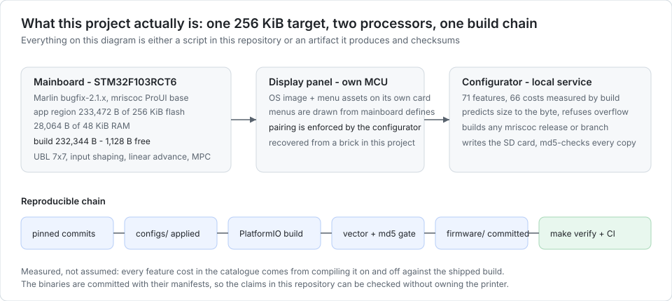
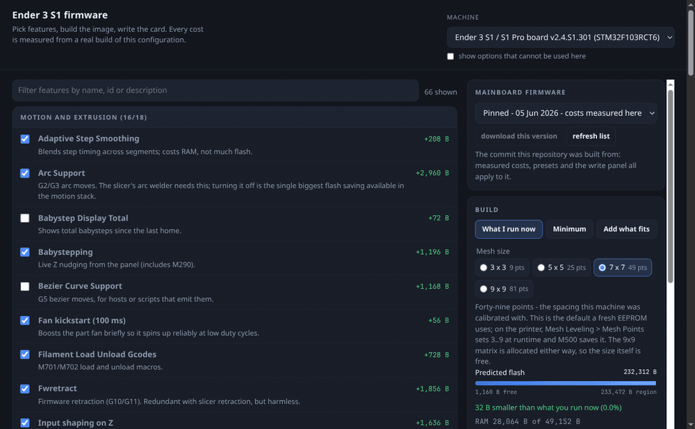
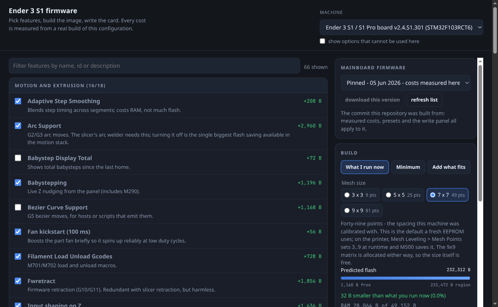
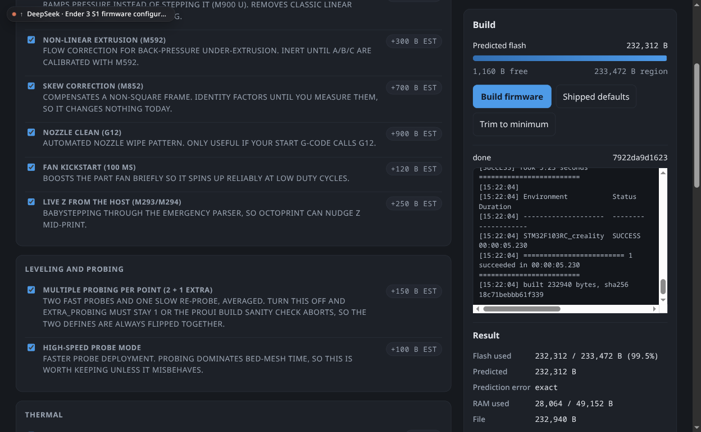
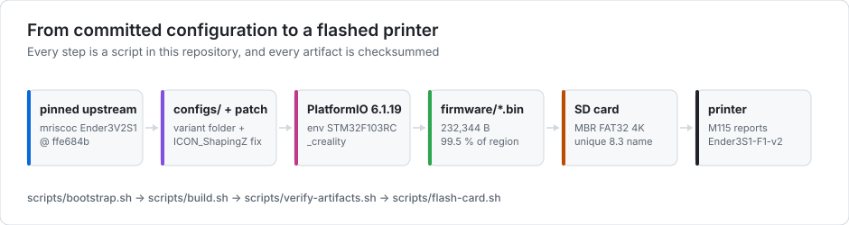
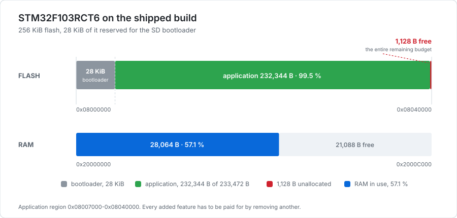

# This project on a CV

Short, honest, and checkable. Every number here comes from a file in this
repository, and each row links to where it is proven.

## One line

> A local firmware factory for Ender 3 S1-class printers: choose any upstream
> mriscoc checkpoint, tick features, and get a verified, checksummed image and a
> written SD card - with every feature's byte cost measured, not estimated.

## Thirty seconds

Ender 3 S1-class printers run Marlin on an STM32F103 with 233,472 bytes of usable
flash, and a tenth of the chip is already gone to the bootloader. I built a
local service that turns 'I want these features, on that upstream checkpoint'
into a compiled, verified image: it fetches any mriscoc release tag or branch,
applies a 71-feature selection, predicts the size to the byte because every
feature's cost was measured by compiling it on and off, refuses what cannot fit,
and writes the SD card for both processors. The reference build it was written
for is in this repository with the full receipts; the display bricked during
that work, and the recovery kit is here too.

## CV bullets (paste-ready)

- Built a **firmware build service** (Python stdlib HTTP service + vanilla JS, no
  framework) that assembles custom Marlin images from **any upstream mriscoc
  checkpoint** - release tags and branches, fetched on demand - applying a
  71-feature selection and refusing selections that cannot fit.
- Measured **every feature's cost** by compiling it on and off (`measure.py`) and
  wrote the deltas back into a catalogue - 71 features, 66 measured - giving a
  predictor whose error on the reference build is **0 bytes**.
- Closed the loop in the service: compile, **verify the ARM vector table**, check
  the budget, and **write a bootable FAT32 card** for the mainboard and the display
  with md5 verification of every copy - all from the browser.
- Recovered a **bricked display panel** by isolating a mismatched asset pack,
  and shipped the recovery kit plus the evidence trail
  ([docs/SCREEN.md](SCREEN.md)).
- Kept the whole chain reproducible and enforced: pinned upstream commits,
  committed binaries with manifests, `make verify` (checksums, vector tables,
  configuration assertions, documentation links, 14 live service checks) and
  three GitHub Actions workflows.

## What is mine, and what is upstream

Recruiters ask. This is the honest split.

| Mine | Upstream (mriscoc / Marlin / Creality) |
|---|---|
| The configuration as a versioned artefact, its rationale, and every hand edit with `file:line` | Marlin itself and mriscoc's ProUI layer |
| The measurement harness, the feature catalogue and the size predictor | The compiler and PlatformIO |
| The configurator (service, UI, build pipeline, SD-card writer, bundle) | The firmware it compiles |
| The screen recovery procedure and the verified OS/asset pairing | Creality's display OS images |
| The documentation, the verification gates and CI | The bootloader on the board |

I do not claim to have written the firmware. I claim to have specified,
measured, built, recovered, documented and automated it - which is what the job
actually is.

## Skills, each with a receipt

| Skill | Evidence |
|---|---|
| Embedded C configuration and constraint budgeting | [docs/DESIGN-NOTES.md](DESIGN-NOTES.md) - every choice, its cost in bytes, and what was rejected |
| Build systems and reproducibility | [docs/BUILD.md](BUILD.md), pinned commits in [configs/](../configs) |
| Measurement instead of estimation | [tools/configurator/README.md](../tools/configurator/README.md) - the catalogue and the prediction error |
| Python service and tooling | [tools/configurator/server.py](../tools/configurator/server.py), [scripts/](../scripts) (stdlib only, no framework) |
| Front-end without a framework | [tools/configurator/web/](../tools/configurator/web), decisions in [docs/UI-NOTES.md](UI-NOTES.md) |
| Test and verification design | `make verify`, [scripts/selftest-configurator.py](../scripts/selftest-configurator.py) (14 behavioural checks) |
| CI/CD | [.github/workflows/](../.github/workflows) - verify, build, configurator |
| Hardware debugging and recovery | [docs/SCREEN.md](SCREEN.md), [docs/TROUBLESHOOTING.md](TROUBLESHOOTING.md) |
| Technical writing | the docs set, and the measured claims inside it |

## Three things worth asking me about

1. **The constraint.** 1,128 bytes free is not a feature list, it is an exercise
   in deciding what not to ship. The measured costs let me say "this option costs
   4,224 bytes and I want it more than those three" instead of guessing.
2. **The brick.** The display went black but backlit after a mismatched asset
   pack was flashed. Separating mainboard health from display health, finding the
   matching OS image, and writing the recovery down is the part of the project I
   would most want to be asked about.
3. **The harness.** Predicting a compiled size to the byte required measuring
   marginal costs against two baselines, then proving the predictor against real
   builds - and documenting where it is only an approximation.

## Checking it without the printer

- `make verify` - checksums, ARM vector tables, configuration assertions, link
  check, and 14 live checks against the configurator service.
- GitHub Actions: **verify** on every push (green), a **weekly full rebuild from the
  pinned upstream** (green, about two minutes), and a **configurator workflow**
  that bootstraps, applies a feature selection and compiles it with no local
  machine involved (green).
- `./scripts/configurator.sh` - the whole build chain, one command.
- Committed binaries in [firmware/](../firmware) and [screen/](../screen) with
  their manifests and MD5s.

## Links

- Live landing page: <https://darthinvader.github.io/Ender3S1Firmware/>
- Repository: <https://github.com/darthinvader/Ender3S1Firmware>

## Media

| | |
|---|---|
|  | The configurator in motion: filter, change the mesh, build, read the result |
|  | The configurator: 71 features, measured costs, live flash budget |
|  | A real build: flash used, prediction, error, RAM, sha256 |
|  | Configuration to flashed image, every step a script |
|  | The 256 KiB budget and what eats it |

